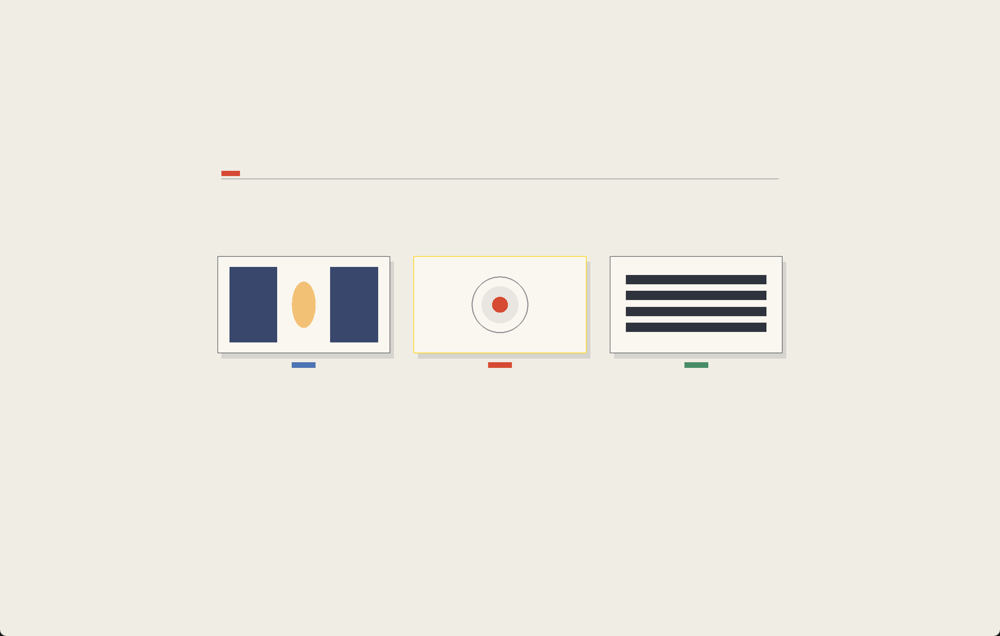

# rigProject



Host **project** envelope (`CProject` / `CPage` PODs) + `.rig` **document** IO, plus Contract `rig.*` import (`ContractImport.h`). Depends on rigComponent for registration order.

## Pages

Header-only: register **rigProject**, `#include "rig/pages.h"`, call `makePage`:

```cpp
#include "rig/pages.h"
#include "rig/sketch.h"

rig::makePage(520.f, 380.f); // CPage + board + paper plate
rig::setFill(0.2f, 0.7f, 1.f);
rig::circle(260.f, 190.f, 40.f); // parents to currentPage
rig::setPage(0);                 // placement only; view stays
// view: rig::focusPage(0);

// update - design-space view + pointer (central dock * design/fb)
rig::pollPageNav(nav);
rig::setPageLayout(rig::PageLayout::Single); // or Stack
// window (needs rigDocumentShell + rigImGui):
#include "PagesWindow.h"
wm->createWindow<rig::PagesWindow>();
```

Pages sit under each other on a board group, centered in the view. Drag pans; wheel zooms toward the cursor. **Scroll** shows the stack; **One page** hides the rest. The Pages panel lives on **rigDocumentShell**. PDF emit is **rigPdf**.

## Lingo: document vs project

- **Document** = portable Contract JSON (`entities[].components` with `rig.*` schema ids). On disk that is a `.rig` file, or a `.rigz` ZIP when sidecar files travel with it. What RigViewer presents and RigPlayer plays.
- **Project** = the host-side working envelope (`CProject` / `CPage`) inside a RigKit host session. This pack owns it.

Contract JSON is the only document dialect: what this pack writes is what RigViewer reads. `tools/contract_smoke` ("save is readable by Contract import") holds that seam shut.

## Package (`.rigz`)

A small document is one `.rig` file. When files travel with it, the Contract package is **`.rigz`**: a ZIP whose archive root holds exactly one `.rig`, beside a `data/` folder. `data/` holds the sidecars, and those files may themselves be `.rig` documents. `rig.media.asset_ref` paths are relative to `data/`. Unzipped, the same layout is the root `.rig` next to a sibling `data/`.

`openPackage` / `writeRigz` read and write that ZIP. `requestSave` / `requestLoad` still read and write the JSON file. `setFileExtension` only changes the loose-file suffix. [Interchange](https://github.com/rigkid/RigWorks/blob/main/docs/interchange.md#package).

## Serialize (`.rig` document)

- Root shape: `{ "rig": "<contract version>", "document": {...}, "entities": [...] }`
- Entity shape: `{ "id": "e12", "components": { "rig.spatial.transform": {...} } }` - the name rides in `rig.meta.named`
- Every codec carries a schema id: `rig.*` where the Contract defines the shape, `x.<vendor>.*` for host-only data. Registration refuses a codec without one, so nothing reaches a file unlabelled.
- **This pack walks codecs and owns the page envelope.** Floor sketch codecs file from **rigSystems**. Domain codecs file from the code pack that fulfills the POD (**rigMilk**, **rigManifold**, **rigAudio**, ...). Data packs announce the type; they do not own the JSON. Use `project::addSerializer` from the code pack's `setup()`.
- Skips: Selection (session), Canvas/Texture (non-portable), document metadata entity in `entities[]`
- Optional root extension writer/reader for domain envelopes (e.g. plotter)

### File extension

Default is **`.rig`**. Apps can switch without changing the JSON shape:

```cpp
doc->setFileExtension("rig");     // default
doc->setFileExtension("rigdoc");  // longer form
doc->requestSave(doc->documentPath(AppPaths::getDataDir() + "/show"));
doc->requestLoad(AppPaths::getDataDir() + "/show"); // appends preferred ext if missing
```

Paths that already include a suffix (`.rig`, `.rigdoc`, `.json`, etc.) are left alone.

## Contract import (`rig.*` JSON)

Reads [RigWorks](https://github.com/rigkid/RigWorks) documents from any host, including the ones this pack writes.

```cpp
#include "ContractImport.h"

// Prefer the pack codec table so import and .rig save share one deserialize path.
auto result = rigkit::project::importContractJson(*ecs, jsonText, path, doc->serializer().registry());
if (!result.ok) { /* result.error */ }
```

Pass the document pack's registry when available. Relationship still remaps by Contract document id (not `eN` handles). UI panel / control / action rows stay on `ContractImportResult` as layout only. `rig.media.code`, paint.solid present fallback, and material to fill stay special-cased.

## Build Example

```bash
cmake -S examples/document -B examples/document/build
cmake --build examples/document/build --target document
```

[API/docs](https://rigkid.github.io/rigProject/)
